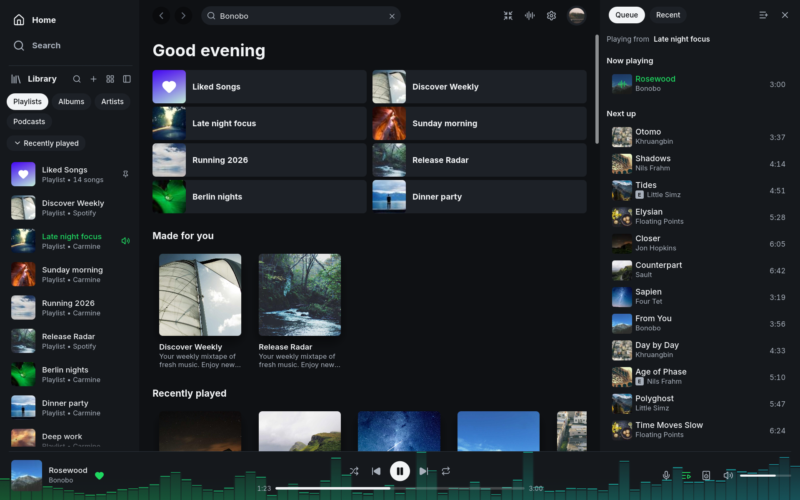
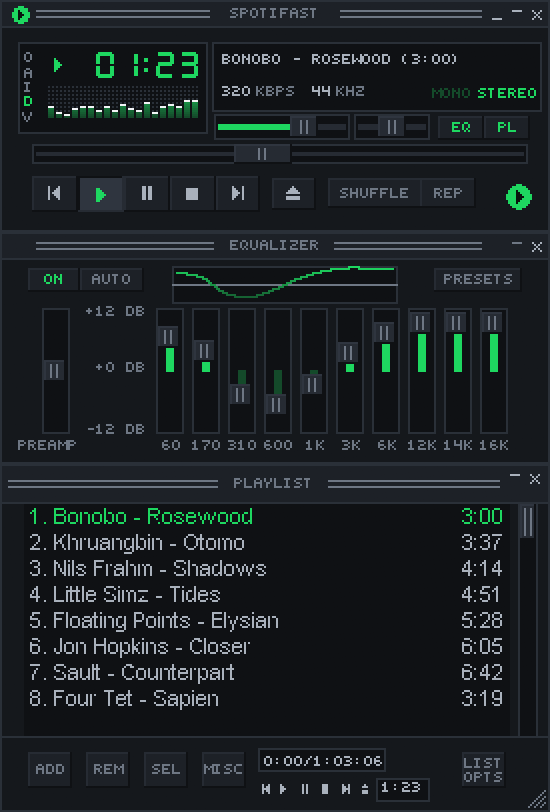
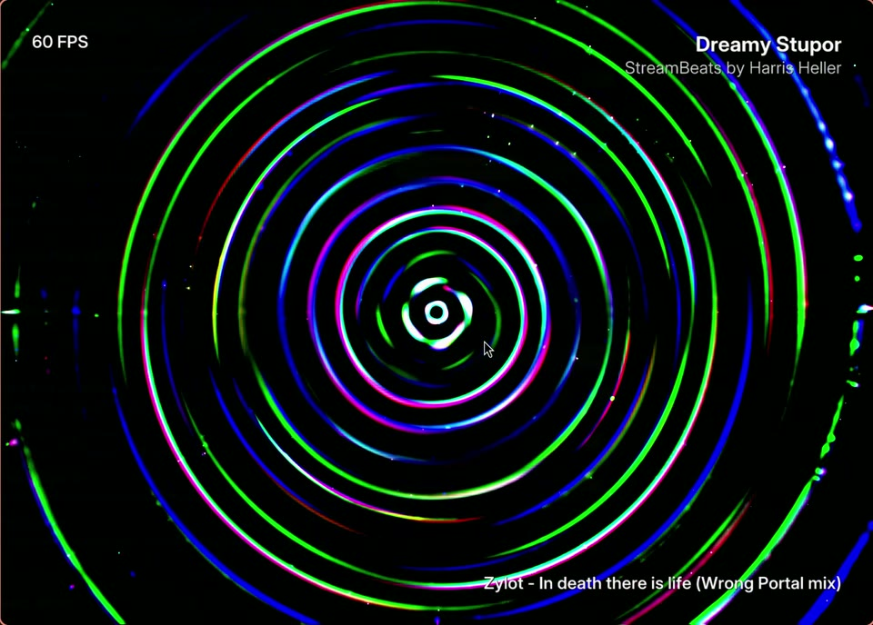

  

<h1 align="center">Spotifast</h1>

<strong>Spotify, native and fast.</strong> A lightweight music app for Linux, macOS, and Windows.

  <a href="../../releases"><strong>Download</strong></a> ·
  <a href="../../releases">Getting started</a> ·

  
  
  

Spotifast is a Spotify client written in Rust with
[egui](https://www.egui.rs) and [fastframe](https://fastframe.dev), the
framework behind a family of native desktop apps.

<strong>Watch Spotifast in action</strong>

https://github.com/user-attachments/assets/a5f669ce-b3b7-4f8e-9933-976a78876c7e

[Features](#your-music-on-your-desktop) · [Install](#install) · [First playback](#start-listening) · [Mini player](#the-winamp-mini-player) · [MilkDrop](#music-in-motion) · [Help](#guides-and-help)

Since 0.15, setup leads with Spotify's
Soloist player, with guided key setup,
one-time pairing and automatic renewal of expiring builds. New listeners and
people updating see this choice once after sign-in on supported platforms.
**Use the built-in player** keeps librespot, with Spotifast's EQ, visualizers,
local files and full queue editing. The choice is remembered.
On Linux with PipeWire, Soloist also supports Spotifast’s EQ and visualizers
through a private audio route.
adds EQ and visualizers on macOS 14.2 or newer, and visualizers on Windows 11,
including MilkDrop. Windows Soloist playback does not support audible EQ.
The Mac route keeps Soloist at full volume after redirecting its output,
then applies Spotifast’s volume after the visualizers, including mute. Phone
volume changes adjust that output level; Spotify’s indicator returns to 100%.
Windows visuals keep their level as Soloist’s volume falls and stop only when it is muted.
When enabled, Soloist appears as **This computer**; settings show the controls
that apply to it. Turning it off restores the built-in player's preferences.
While Soloist starts and its account is verified, the Spotify loading screen shows
**Verifying Soloist…** and waits to accept playback commands. Setup takes three
steps, and ends with choosing the named device in Spotify, with the built-in
player available as a quiet alternative below the card. If Soloist stops later,
a banner over the app says so while Spotifast restarts it, and offers **Try
again** if that does not work. **Settings → Spotify Soloist → Spotify access**
connects the separate Spotify session for Made for you, listening activity and
Spotify lyrics without changing players.

## Your music, on your desktop

| Feature | What you can do |
|---|---|
| **Library and search** | Browse playlists, Liked Songs, albums, artists, and podcasts. Discover upcoming albums on artist pages and open their countdown to pre-save. Search the catalogue and edit playlists you own. Copy a song's link, title, or artists from its menu. |
| **Local files** | Play the local files your playlists list from a folder you choose in Settings, at any sample rate. Names show spaces and accents correctly, including in cached playlists. |
| **Lyrics** | Spotify lyrics when the playback session is signed in, with LRCLIB as fallback. Temporary LRCLIB overloads retry and try search; older cached lyrics remain available during outages. |
| **Spotify Connect** | Play on this computer or control playback on your other devices, including Google Cast speakers and groups. Cast devices appear as they are discovered; frequently and recently chosen outputs rise to the top. Remote volume keeps your chosen level while Spotify updates. |
| **Queue** | Add songs to the queue, or choose **Play next** to put a song or selection first when playing on this computer. |
| **Themes** | Choose light, dark, system appearance, or custom colours, with one theme for light mode and one for dark mode that switch with the system. On Omarchy, follow your desktop theme, in the panel, selection and muted shades each theme defines ([details](https://spotifast.rocks/settings-and-files/#follow-an-omarchy-theme)). |
| **Desktop controls** | Use keyboard shortcuts and media keys. Keep music playing from the tray when supported by your desktop and settings, and start Spotifast with your computer, with its window or in the tray. |
| **Winamp mini player** | Use classic skins with an equalizer, playlist, and animated sound displays. |
| **MilkDrop** | Watch music-reactive visuals in a separate window or full screen. See platform availability below. |

## Install

[View all releases](../../releases)

| Platform | Download | Run |
|----------|----------|-----|
| **Windows x64** | [spotifast-x64.7z](../../releases) | Run installer → launch `spotifast-x64.7z` |
| **Linux x64** | [spotifast-Linux-x64.run](../../releases) | `chmod +x` → run installer |
| **macOS Apple Silicon** | [spotifast-macOS-arm64.dmg](../../releases) | Open DMG → drag to Applications |

## Start listening

1. Register Spotifast with Spotify, as the sign-in screen shows: in the
   [Spotify developer dashboard](https://developer.spotify.com/dashboard),
   click **Create app**, Spotify's name for this registration, with the
   redirect URI `http://127.0.0.1:8989/login` and **Web API** ticked. It takes
   about two minutes and gives you a Client ID. Spotify requires Premium on the
   account that registers, so a Free account can't do this step itself.
2. Paste the Client ID into Spotifast and choose **Sign in with Spotify**.
   Approve access in your browser, then return to the app to see your library.
3. To listen on this computer, open the device menu in the bottom player bar
   and choose **Set up playback here**, also available in Settings.
4. Complete the separate playback approval in your browser. Your computer
   appears as a Spotify Connect device named **Spotifast**.

## The Winamp mini player

A classic look for your music, with Winamp 2 `.wsz` and Windows Media Player `.wmz` skins, an equalizer,
a playlist, and animated sound displays. Switch with **Ctrl+M**
(**Cmd+Shift+M** on macOS), the shrink button, or Settings.
The spectrum analyser and oscilloscope also work in the collapsed title bar.

  

## Music in motion

MilkDrop reacts to music playing on this computer, with more than 10,000
presets downloaded on first use. Open it from the visualiser button,
Settings, or the mini player's **V** menu.

## Spotify Connect updates

With local playback enabled, Spotify pushes changes from other devices over
Spotifast's existing Connect session. Playback changes trigger a refresh.
Volume-only changes appear directly for the active playback device without
an extra request; an unconfirmed volume change made in Spotifast takes
precedence. Push-triggered refreshes are at least a second apart and wait for
a pending playback read to finish. Changes received during that read are
folded into one follow-up.
Connect pushes are ignored when this computer is the active device both
before and after; position-only updates cause no requests. Regular polling
remains the fallback.

## Sonos playback

Sonos speakers use the Spotify Connect session for playback control. Enable
local playback first, then select the speaker in the device picker.

## Acknowledgements

Spotifast is an independent project and is not affiliated with Spotify.
Spotify is a trademark of Spotify AB.

Licensed under the [MIT License](LICENSE).

## Star history

<a href="https://www.star-history.com/?repos=crmne%2Fspotifast&amp;type=date">
  <picture>
    <source media="(prefers-color-scheme: dark)" srcset="https://api.star-history.com/chart?repos=crmne/spotifast&amp;type=date&amp;theme=dark">
    
  </picture>
</a>
